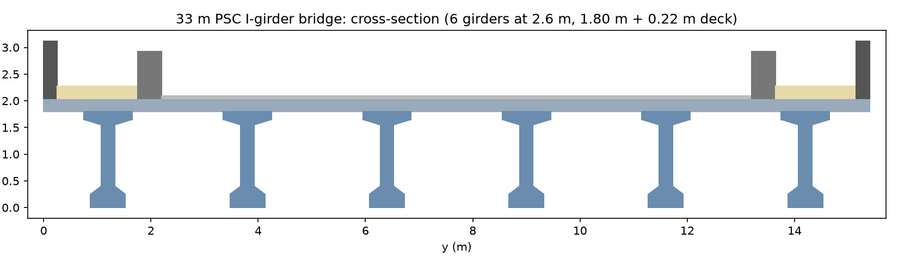
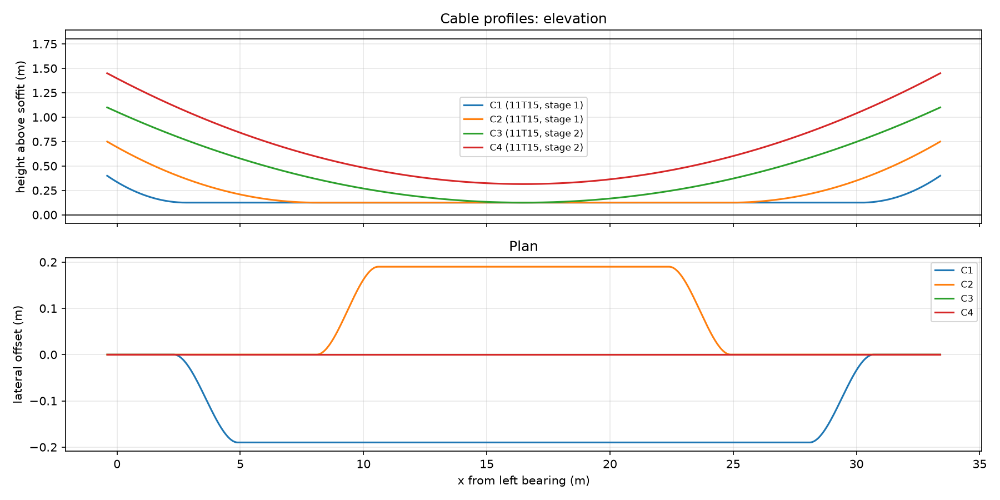
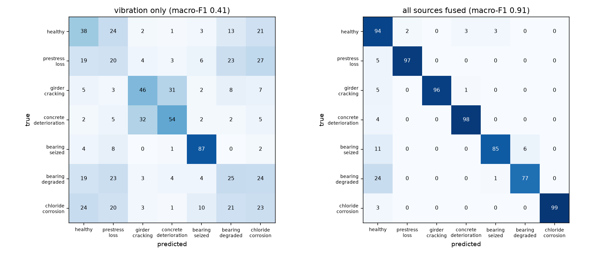
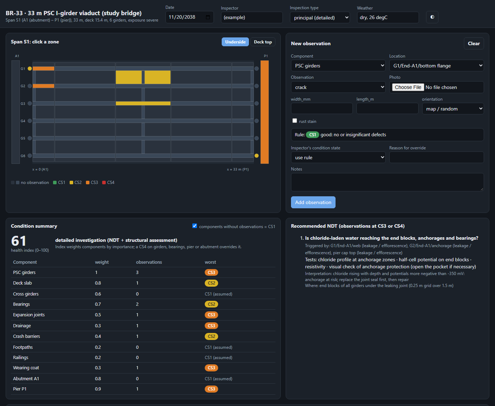

# 33 m PSC I-girder bridge: design to AI/ML-assisted maintenance

An integrated study of a 33 m simply supported, post-tensioned PSC I-girder bridge, carried from structural analysis and prestress design through a healthy baseline, inspection and NDT programme, synthetic deterioration data and ML condition assessment, to a maintenance scheme. Each step is a plain Python script. The final report reads every number from the analysis outputs, so the two cannot drift apart.

The project was done for *CE60258 AI/ML for Sustainable Infrastructure Systems* (One-Month Integrated Big Problem). **Read the full report: [report/report.pdf](report/report.pdf).**

## The bridge

| | |
|---|---|
| Span | 33.0 m c/c of bearings |
| Deck | 15.4 m wide: 11.0 m carriageway (3 lanes), 1.5 m footpaths, crash barriers and railings |
| Girders | 6 precast PSC I-girders at 2.6 m, 1.8 m deep, M45; 220 mm in-situ M35 deck slab |
| Prestress | 4 × 11T15 cables (15.2 mm strands), two-stage stressing |
| Codes | IRC:6 (loads), IRC:112-2020 (design) |

All parameters are in [bridge/config.py](bridge/config.py).

<p align="center">
  
  
</p>

## Pipeline

| Step | Script | What it does |
|---|---|---|
| 1 | `run_step1_analysis.py` | Section properties, dead and live loads, grillage analysis with a moving-vehicle search, design load effects per girder |
| 2 | `run_step2_design.py` | Cable layout, friction/slip and time-dependent losses, stage stresses, SLS and ULS checks |
| 3 | `run_step3_baseline.py` | Healthy baseline: modal properties, load-test predictions, long-term reference curves, simulated vibration identification, thermal sensitivities, monitoring scheme |
| 4 | `run_step4_inspection.py` | Visual inspection scheme, NDT programme, and the offline inspection app |
| 5 | `run_step5_synthetic.py` | Synthetic inspection, NDT and monitoring campaigns for a healthy bridge and six deterioration mechanisms at varying severity |
| 6 | `run_step6_ml.py` | Temperature compensation, anomaly detection, damage classification, severity regression, girder localisation, clustering |
| 7 | `run_step7_maintenance.py` | Decision logic for every campaign and a 30-year proactive vs. reactive life-cycle comparison |
| – | `report/build_report.py` | Builds `report/report.html` and `report/report.pdf` from `outputs/` |

The modelled deterioration mechanisms are prestress loss, girder cracking, concrete deterioration, a seized bearing, a degraded bearing, and chloride-induced corrosion.

## Headline results

These results are on the synthetic test campaigns (step 6).

- **Anomaly detection** was trained on healthy campaigns only. Fusing all data sources gives 88.6 % detection at 0 % false alarms (AUC 0.95). Vibration alone gives 36.4 % detection.
- **Damage-type classification** with a fused random forest reaches macro-F1 0.91. The best single source, visual inspection, reaches 0.75.
- **Prestress loss** is estimated from monitoring plus the other sources with an MAE of 3.2 % of the effective prestress.
- **Maintenance logic** (step 7) sends no healthy bridge to repair and leaves no severely damaged bridge on routine monitoring.

<p align="center">
  
</p>

## Repository layout

```
bridge/            analysis package: config, section, loads, grillage, moving loads, prestress,
                   long-term, vibration, monitoring, inspection, synthetic data, ML, maintenance
run_step*.py       the seven pipeline steps (run from the repository root)
tests/             hand-check tests per step
inspection_app/    offline single-file inspection app (index.html is generated by step 4)
outputs/           JSON results, figures, logs and the synthetic data set
report/            report builder and the built report (HTML + PDF)
```

## Getting started

You need:

- **Python 3.14**.
- **Node.js**, only for `tests/test_step4.py`. It checks that the app's JavaScript rules match `bridge/inspection.py`.
- **Chrome, Chromium or Edge**, only to export the report to PDF and screenshot the inspection app. Without one, the HTML report is still built.

```bash
python -m venv .venv
source .venv/bin/activate        # Windows: .venv\Scripts\activate
pip install -r requirements.txt
```

### Run the pipeline

Run the steps in order from the repository root. Each step reads the previous steps' outputs from `outputs/`.

```bash
python run_step1_analysis.py
python run_step2_design.py
python run_step3_baseline.py
python run_step4_inspection.py
python run_step5_synthetic.py            # optional args: [campaigns per class] [workers], default 340 8
python run_step6_ml.py
python run_step7_maintenance.py
python report/build_report.py
```

Step 5 is the slow one. With the defaults (7 classes × 340 = 2380 campaigns on 8 workers) it took about 70 minutes. For a quick trial run, use fewer campaigns, for example `python run_step5_synthetic.py 40 4`. The ML results will then differ from the report.

### Committed outputs

`outputs/` is committed, including the synthetic data set. You can read the report and figures, or rerun steps 6 and 7, without regenerating step 5. The one exception is the trained model file `outputs/models.joblib`. Step 6 recreates it in a few minutes, and it must exist before step 7 or the report build.

### Tests

```bash
# macOS / Linux
for t in tests/test_step*.py; do PYTHONPATH=. python "$t"; done
```

```powershell
# Windows PowerShell
$env:PYTHONPATH = "."; Get-ChildItem tests\test_step*.py | ForEach-Object { python $_.FullName }
```

Each file prints `ok <test name>` for every passing check. The same tests run in GitHub Actions on every push.

## Inspection app

[inspection_app/index.html](inspection_app/index.html) is a self-contained, offline page for recording a visual inspection:

- Click a component on the bridge drawing and record defects and condition states.
- The app applies the same condition-state rules as the Python model.
- Records are saved in the browser and can be exported as CSV or JSON.

Open the file in any browser; it needs no server. The page is generated by step 4 from `template.html` and `rules.js`, so edit those two files rather than `index.html`.

<p align="center">
  
</p>

## Author

Durgesh Kumar. Course instructor: Prof. Nirjhar Dhang.
